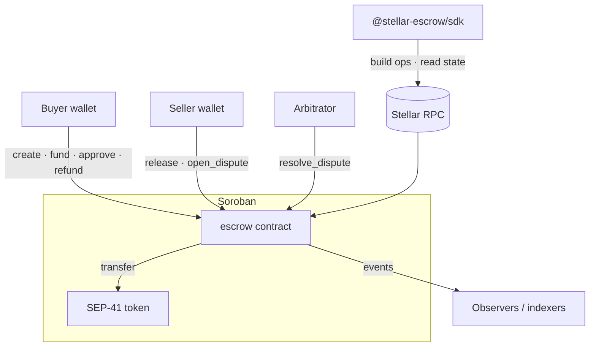

# stellar-escrow

**Programmable B2B escrow and milestone settlement infrastructure for Stellar.**

[](https://github.com/StellarOpenInfrastructure/stellar-escrow/actions/workflows/ci.yml)
[](https://github.com/StellarOpenInfrastructure/stellar-escrow/actions/workflows/security.yml)
[](LICENSE)
[](docs/security/threat-model.md)
[](docs/drips-wave.md)

> A Soroban contract that holds a buyer's tokens against a seller's milestones,
> with approvals, expiration-based refunds and arbitrated disputes — plus a
> TypeScript SDK to drive it.

**⚠️ NOT AUDITED · EXPERIMENTAL.** Do not use with real value until an audit is
linked from [`docs/security/threat-model.md`](docs/security/threat-model.md).

---

## Problem

Businesses paying for staged work — software, logistics, manufacturing,
creative services — either pay up front and hope, or pay late and hurt the
supplier. Traditional escrow is slow, expensive and jurisdiction-bound. On
Stellar, funds can be held programmatically, released per milestone and
adjudicated by a chosen arbitrator, in any SEP-41 token.

## Solution

One Soroban contract with five responsibilities:

| Module       | Purpose                                                                     |
| ------------ | --------------------------------------------------------------------------- |
| `escrow`     | create, fund, cancel                                                        |
| `milestones` | buyer approves individual milestones                                        |
| `release`    | pay approved milestones to the seller                                       |
| `refund`     | buyer reclaims unreleased funds after expiration                            |
| `dispute`    | either party freezes; the arbitrator splits remaining funds by basis points |

Each escrow records `buyer`, `seller`, `arbitrator`, `asset`, `amount`,
`expiration` and up to 32 milestones. Every state change emits a typed event.

## Why Stellar

- Soroban's `require_auth` gives a clean, per-party authorization model
  without signature parsing in the contract.
- SEP-41 tokens (including USDC and native XLM via the Stellar Asset
  Contract) mean one contract serves every asset.
- Low, predictable fees make per-milestone releases economical.
- Contract events let payment providers, dashboards and
  [stellar-contract-observer](../stellar-contract-observer) track escrows
  without polling.

## Architecture



State machine, storage layout and events:
[docs/architecture/overview.md](docs/architecture/overview.md).

### Stellar infrastructure consumed

| Component     | Uses                                                                                 |
| ------------- | ------------------------------------------------------------------------------------ |
| contract      | Soroban host: auth, persistent/instance storage, TTL, events, SEP-41 `token::Client` |
| SDK           | Stellar RPC `simulateTransaction` (reads), `@stellar/stellar-sdk` XDR                |
| deploy script | Stellar CLI                                                                          |

No Horizon, no indexer.

## Features

- ✅ Create / fund / cancel
- ✅ Up to 32 milestones with descriptions
- ✅ Buyer approval, release by buyer or seller
- ✅ Expiration-based refund of unreleased funds
- ✅ Disputes with arbitrator basis-point split
- ✅ Checked arithmetic, `overflow-checks` on in release
- ✅ Typed events (`#[contractevent]`)
- ✅ 14 contract tests: happy paths, authorization, failure paths, edge cases
- ✅ TypeScript SDK: invocation builders, decoders, RPC reads, error mapping
- ✅ 35 KB optimized wasm
- ⏳ Arbitrator timeout / mutual termination — roadmap
- ⏳ Fee-on-release for platforms — roadmap

## Repository structure

```
stellar-escrow/
├── contracts/
│   ├── Cargo.toml              # workspace, release profile
│   └── escrow/src/
│       ├── lib.rs              # public interface
│       ├── escrow.rs milestones.rs release.rs refund.rs dispute.rs
│       ├── types.rs errors.rs storage.rs events.rs
│       └── test.rs
├── sdk/                        # @stellar-escrow/sdk (TypeScript)
├── examples/                   # create-escrow.ts, milestone-plan.json
├── scripts/deploy-testnet.sh
├── docs/
│   ├── security/threat-model.md
│   ├── architecture/ api/ guides/ adr/
│   └── drips-wave.md
└── Makefile
```

No `backend/` or `frontend/`: the contract is self-contained and wallets
integrate through the SDK. A reference web UI is a Drips Wave issue.

## Requirements

- Rust stable (≥ 1.84) with `wasm32v1-none` target
- Node.js ≥ 22, pnpm ≥ 10
- Stellar CLI (deployment only)

## Installation

```bash
git clone https://github.com/StellarOpenInfrastructure/stellar-escrow
cd stellar-escrow
make setup
```

## Configuration

`.env.example` documents the variables used by examples and the deploy
script. The contract itself has no configuration.

## Development

```bash
make contract-test      # cargo test
make contract-lint      # fmt + clippy -D warnings
make contract-build     # wasm
make test               # contract + SDK tests
make lint && make typecheck && make build
```

## Testing

Contract tests (`contracts/escrow/src/test.rs`) cover:

- unit: create, fund, approve, release, refund, dispute, events
- authorization: buyer-only, arbitrator-only, party checks (`Unauthorized`)
- failure paths: wrong status, double release, refund before expiry, refund
  during dispute, bad basis points, unknown ids
- edge cases: overflow on milestone sum, 33 milestones, rounding in splits,
  expiration boundaries

SDK tests cover encoding of every invocation, decoders and error mapping.
Property/fuzz tests are a Drips Wave issue.

## API

Contract interface: [docs/api/README.md](docs/api/README.md).

## SDK

```ts
import { EscrowClient } from "@stellar-escrow/sdk";

const client = new EscrowClient({ contractId, networkPassphrase, rpcUrl });
const op = client.createOp({ buyer, seller, arbitrator, asset, milestones, expiration });
// add op to a transaction → server.prepareTransaction → sign as buyer → send
const escrow = await client.readEscrow(0n);
```

## Contracts

`contracts/escrow` — see module map above. Contract errors and their codes are
listed in `sdk/src/types.ts`.

## Deployment

```bash
stellar keys generate --global deployer --network testnet
STELLAR_DEPLOYER=deployer make contract-deploy-testnet
```

Record shared deployments in `docs/deployments.md` (contract id, wasm hash,
network, date).

## Security

[SECURITY.md](SECURITY.md) · [Threat model](docs/security/threat-model.md)

## Threat model

Summary (full version in `docs/security/threat-model.md`):

- **No admin, no upgrade** — nothing can change escrow logic while funds are held.
- **Checks-effects-interactions** — state is written before every transfer.
- **Bounded arbitrator power** — can only split one escrow's remaining funds
  between its own buyer and seller.
- **Known gap** — an unresponsive arbitrator locks disputed funds.

## Roadmap

1. Arbitrator timeout → buyer refund path
2. Mutual early termination while funded
3. Platform fee on release
4. Configurable TTL extension
5. Fuzz/property tests
6. Reference web UI
7. Independent audit

Backlog: [docs/drips-wave.md](docs/drips-wave.md).

## Contributing

See [CONTRIBUTING.md](CONTRIBUTING.md).

## Drips Wave contribution areas

| Area     | Examples                                                        |
| -------- | --------------------------------------------------------------- |
| Contract | new state transitions, fee module, TTL policy, gas optimisation |
| Tests    | fuzzing, property tests, auth matrices                          |
| SDK      | event decoders, typed contract client generation, React hooks   |
| Docs     | integration guides for wallets and marketplaces                 |
| DevOps   | testnet deployment workflow, wasm size tracking                 |

## License

Apache-2.0.

## Disclaimer

Experimental software. Not audited. No warranty. Do not hold real value in
this contract until an audit is published and linked here.
