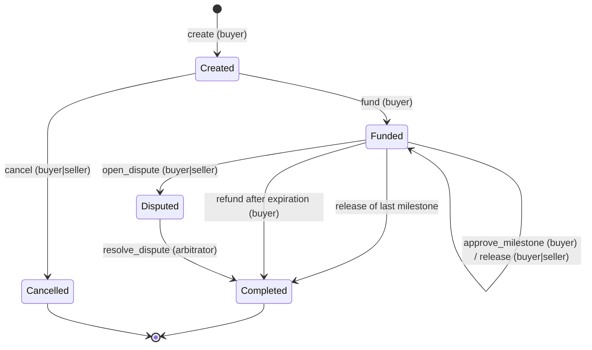
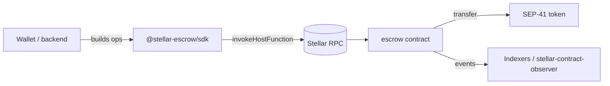

# Architecture

## State machine

Milestones: `Pending → Approved → Released`, or `Pending|Approved → Refunded`
(refund or dispute resolution).

## Components

- **Contract** (`contracts/escrow`): all business rules, no admin.
- **SDK** (`sdk`): typed invocation builders and RPC readers. Never signs.
- **Stellar infrastructure**: Stellar RPC for simulation, submission and
  reads; contract events for off-chain tracking. No Horizon dependency.

## Storage layout

| Key                    | Type        | Storage    |
| ---------------------- | ----------- | ---------- |
| `Count`                | `u64`       | instance   |
| `Escrow(id)`           | `Escrow`    | persistent |
| `Milestone(id, index)` | `Milestone` | persistent |

## Events

`created`, `funded`, `cancelled`, `approved`, `released`, `refunded`,
`disputed`, `resolved` — each with `escrow_id` as topic and a map of named
fields as data (see `contracts/escrow/src/events.rs`).
